# TRACED — Deception System

TRACED is a lightweight deception and canarytoken orchestration platform designed for red team and threat detection engagements. It deploys instrumented lures (file artifacts, canary tokens) onto target hosts via a distributed agent fleet, then monitors and correlates trigger events to detect adversary activity.

## How it works

The system has three components that work together:

```
Operator (ops API)
      │
      ▼
┌─────────────┐       poll/checkin       ┌─────────────┐       poll/checkin       ┌─────────────┐
│  Controller │ ◄──────────────────────► │    Relay    │ ◄──────────────────────► │    Agent    │
│  (port 8443)│                          │  (port 9443)│                          │  (host)     │
└─────────────┘                          └─────────────┘                          └─────────────┘
      │                                        │
      │  ECS events / canary webhooks          │  ECS events → syslog
      ▼                                        ▼
 SQLite DB                              Security Onion
 Rules engine                           (optional SIEM)
 Alerts
```

**Controller** — the brains. Manages campaigns, objects, tokens, and the relay/agent fleet. Accepts canary webhook callbacks, evaluates detection rules, and raises alerts. Exposes an ops API for campaign lifecycle management.

**Relay** — a lightweight edge node that sits closer to targets. Buffers jobs for agents, accepts agent checkins and results, and forwards ECS telemetry upstream to the controller and optionally to Security Onion via syslog. Can be deployed as a systemd appliance via `bootstrap-relay.sh`.

**Agent** — runs on target hosts (or attacker-controlled machines during simulation). Polls the relay for jobs, executes workloads (file artifact drops, Docker containers), and emits ECS-format logs back through the relay.

## Architecture

Component-level view of the controller, relay, and agent tiers and how data flows between them. Nodes link to their source files. Interactive version: [gitdiagram.com/kevopsai/traced](https://gitdiagram.com/kevopsai/traced).

```mermaid
flowchart TD

subgraph group_controller["Controller"]
  node_campaign_api["Campaign API<br/>[app.py]"]
  node_controller_db[("Controller store<br/>[db.py]")]
  node_schemas["API models<br/>[models.py]"]
  node_job_dispatch["Job dispatch<br/>[pusher.py]"]
  node_token_provider["Canary provider<br/>[canary.py]"]
  node_detection_rules["Detection rules<br/>[rules.py]"]
  node_controller_telemetry["Event handling<br/>[telemetry.py]"]
  node_controller_forwarder["SIEM forwarding<br/>[forwarder.py]"]
end

subgraph group_relay["Relay"]
  node_relay_api["Relay API<br/>[app.py]"]
  node_relay_store[("Relay buffer<br/>[db.py]")]
  node_relay_models["Relay messages<br/>[models.py]"]
  node_relay_telemetry["Relay syslog<br/>[telemetry.py]"]
end

subgraph group_agent["Agent"]
  node_agent_runtime["Agent runtime<br/>[main.py]"]
  node_agent_state[("Deployment state<br/>[state.py]")]
  node_file_lure["File artifact<br/>[file_artifact.py]"]
  node_docker_workload["Docker workload<br/>[docker_workload.py]"]
  node_agent_signing["Envelope signing<br/>[signing.py]"]
  node_agent_telemetry["Agent telemetry<br/>[telemetry.py]"]
end

subgraph group_integrations["Integrations"]
  node_canary_service{{"Canarytokens"}}
  node_siem{{"Syslog receiver"}}
end

node_operator(("Operator"))

node_operator -->|"manages campaigns"| node_campaign_api
node_campaign_api -->|"stores campaign data"| node_controller_db
node_campaign_api -->|"uses request models"| node_schemas
node_campaign_api -->|"pushes jobs"| node_job_dispatch
node_campaign_api -->|"creates and downloads tokens"| node_token_provider
node_campaign_api -->|"evaluates detections"| node_detection_rules
node_campaign_api -->|"handles events"| node_controller_telemetry
node_campaign_api -.->|"forwards events"| node_controller_forwarder
node_canary_service -->|"sends hit webhook"| node_campaign_api
node_token_provider -->|"requests tokens"| node_canary_service
node_job_dispatch -->|"delivers jobs"| node_relay_api
node_relay_api -->|"buffers jobs and agents"| node_relay_store
node_relay_api -->|"validates messages"| node_relay_models
node_agent_runtime -->|"checks in and polls"| node_relay_api
node_relay_api -->|"forwards checkins and results"| node_campaign_api
node_agent_runtime -->|"reads and saves deployments"| node_agent_state
node_agent_runtime -->|"applies or removes"| node_file_lure
node_agent_runtime -->|"applies or removes"| node_docker_workload
node_agent_runtime -->|"verifies envelopes"| node_agent_signing
node_agent_runtime -->|"emits workload events"| node_agent_telemetry
node_agent_runtime -->|"posts logs and results"| node_relay_api
node_relay_api -->|"forwards ECS events"| node_controller_telemetry
node_relay_api -->|"forwards to syslog"| node_relay_telemetry
node_relay_telemetry -->|"sends syslog"| node_siem
node_controller_forwarder -.->|"forwards token events"| node_siem

click node_campaign_api "https://github.com/kevopsai/traced/blob/main/controller/app.py"
click node_controller_db "https://github.com/kevopsai/traced/blob/main/controller/db.py"
click node_schemas "https://github.com/kevopsai/traced/blob/main/controller/models.py"
click node_job_dispatch "https://github.com/kevopsai/traced/blob/main/controller/pusher.py"
click node_token_provider "https://github.com/kevopsai/traced/blob/main/controller/providers/canary.py"
click node_detection_rules "https://github.com/kevopsai/traced/blob/main/controller/rules.py"
click node_controller_telemetry "https://github.com/kevopsai/traced/blob/main/controller/telemetry.py"
click node_controller_forwarder "https://github.com/kevopsai/traced/blob/main/controller/forwarder.py"
click node_relay_api "https://github.com/kevopsai/traced/blob/main/relay/app.py"
click node_relay_store "https://github.com/kevopsai/traced/blob/main/relay/db.py"
click node_relay_models "https://github.com/kevopsai/traced/blob/main/relay/models.py"
click node_relay_telemetry "https://github.com/kevopsai/traced/blob/main/relay/telemetry.py"
click node_agent_runtime "https://github.com/kevopsai/traced/blob/main/agent/main.py"
click node_agent_state "https://github.com/kevopsai/traced/blob/main/agent/state.py"
click node_file_lure "https://github.com/kevopsai/traced/blob/main/agent/plugins/file_artifact.py"
click node_docker_workload "https://github.com/kevopsai/traced/blob/main/agent/plugins/docker_workload.py"
click node_agent_signing "https://github.com/kevopsai/traced/blob/main/agent/signing.py"
click node_agent_telemetry "https://github.com/kevopsai/traced/blob/main/agent/telemetry.py"

classDef toneNeutral fill:#f8fafc,stroke:#334155,stroke-width:1.5px,color:#0f172a
classDef toneBlue fill:#dbeafe,stroke:#2563eb,stroke-width:1.5px,color:#172554
classDef toneAmber fill:#fef3c7,stroke:#d97706,stroke-width:1.5px,color:#78350f
classDef toneMint fill:#dcfce7,stroke:#16a34a,stroke-width:1.5px,color:#14532d
classDef toneRose fill:#ffe4e6,stroke:#e11d48,stroke-width:1.5px,color:#881337
classDef toneIndigo fill:#e0e7ff,stroke:#4f46e5,stroke-width:1.5px,color:#312e81
classDef toneTeal fill:#ccfbf1,stroke:#0f766e,stroke-width:1.5px,color:#134e4a
class node_campaign_api,node_controller_db,node_schemas,node_job_dispatch,node_token_provider,node_detection_rules,node_controller_telemetry,node_controller_forwarder toneBlue
class node_relay_api,node_relay_store,node_relay_models,node_relay_telemetry toneAmber
class node_agent_runtime,node_agent_state,node_file_lure,node_docker_workload,node_agent_signing,node_agent_telemetry toneMint
class node_canary_service,node_siem toneRose
class node_operator toneIndigo
```



## Workload types

| Type | What it does |
|---|---|
| `file_artifact` | Drops a lure file on the host at a specified path with configurable content and permissions |
| `docker_workload` | Spins up a Docker container as a workload (e.g. a honeyservice) |

## Campaign lifecycle

1. **Create** a campaign with a name, objective, and tags
2. **Add objects** — lures and tokens associated with the campaign
3. **Deploy** — push jobs to agents via a relay
4. **Monitor** — canary webhooks and agent telemetry flow back and trigger alerts
5. **Teardown** — clean up deployed artifacts from target agents
6. **Purge** — wipe campaign events and rule state from the database

## Token integration

TRACED integrates with [Canarytokens](https://canarytokens.org) to generate and embed tokens within lure artifacts. When a token is triggered, the canary webhook fires to the controller (`/v1/integrations/canary/webhook`), which correlates the hit to the originating campaign and agent, evaluates rules, and raises an alert.

## Telemetry & SIEM

All events are ECS-formatted JSON. The relay forwards events to Security Onion (or any syslog receiver) over UDP/TCP. The controller can also forward token-hit events independently. Both are optional — events are always stored in SQLite regardless.

## Authentication

| Key | Used by |
|---|---|
| `OPS_API_KEY` | Operator → Controller (campaign management, fleet status) |
| `EDGE_API_KEY` | Relay → Controller and Agent → Relay |
| `TRACED_SHARED_SECRET` | HMAC envelope signing between all components |

## Security posture

- All inter-component communication is HMAC-signed
- API keys support a `_PREV` rotation variant for zero-downtime key rotation
- Guardrails enforce rate limits on token creation, deployments, and event ingestion to prevent runaway operations
- Circuit breaker on event ingestion (configurable events/min threshold)

---

## Quick start (controller + relay)

1. Copy env:
```bash
cp .env.example .env
# edit .env — set real values for all keys
```

2. Start:
```bash
docker compose --env-file .env up -d --build
```

3. Verify:
```bash
curl -sS http://localhost:8443/v1/status
curl -sS http://localhost:9443/v1/edge/poll -H "Authorization: Bearer $EDGE_API_KEY"
```

## Run agent locally (no Docker)

```bash
python -m venv .venv && source .venv/bin/activate
pip install -r agent/requirements.txt

export EDGE_URL="http://localhost:9443"
export EDGE_API_KEY="$EDGE_API_KEY"
export EDGE_SHARED_SECRET="$TRACED_SHARED_SECRET"
export RUNNER_ID="host-01"

python -m agent.main
```

## API examples

### Create a campaign
```bash
curl -sS -X POST http://localhost:8443/v1/campaigns \
  -H "Authorization: Bearer $OPS_API_KEY" \
  -H "Content-Type: application/json" \
  -d '{"name":"test-campaign","objective":"mvp","tags":["mvp","engage:prepare"]}' | jq .
```

### Add a file artifact lure
```bash
curl -sS -X POST http://localhost:8443/v1/campaigns/$CID/objects \
  -H "Authorization: Bearer $OPS_API_KEY" \
  -H "Content-Type: application/json" \
  -d '{
    "object_type":"file_artifact",
    "name":"budget-notes",
    "cfg":{"path":"~/Documents/budget-notes.txt","content":"Renewal notes, vendor shortlist.","mode":"0644"},
    "tags":["lure:document","engage:operate"]
  }' | jq .
```

### Deploy to agents via relay
```bash
curl -sS -X POST http://localhost:8443/v1/campaigns/$CID/deploy \
  -H "Authorization: Bearer $OPS_API_KEY" \
  -H "Content-Type: application/json" \
  -d '{"relay_id":"relay-1","target_agent_ids":["host-01"]}' | jq .
```

### Fleet status
```bash
curl -sS http://localhost:8443/v1/ops/status \
  -H "Authorization: Bearer $OPS_API_KEY" | jq .
```

### Campaign ops status
```bash
curl -sS http://localhost:8443/v1/campaigns/$CID/ops \
  -H "Authorization: Bearer $OPS_API_KEY" | jq .
```

### Query alerts
```bash
curl -sS http://localhost:8443/v1/ops/alerts \
  -H "Authorization: Bearer $OPS_API_KEY" | jq .
```

### Teardown
```bash
curl -sS -X POST http://localhost:8443/v1/campaigns/$CID/teardown \
  -H "Authorization: Bearer $OPS_API_KEY" \
  -H "Content-Type: application/json" \
  -d '{"relay_id":"relay-1","target_agent_ids":["host-01"]}' | jq .
```

### Purge campaign data
```bash
curl -sS -X POST http://localhost:8443/v1/ops/campaigns/$CID/purge \
  -H "Authorization: Bearer $OPS_API_KEY" \
  -H "Content-Type: application/json" \
  -d '{"purge_events": true}' | jq .
```

---

## Relay appliance install

On a relay host (Ubuntu 22.04), from the repo root:
```bash
chmod +x deploy/bootstrap-relay.sh deploy/relay_id.sh
sudo CORE_URL=http://CONTROLLER_IP:8443 \
  EDGE_API_KEY="$EDGE_API_KEY" \
  TRACED_SHARED_SECRET="$TRACED_SHARED_SECRET" \
  SO_HOST="SECURITY_ONION_IP" \
  ./deploy/bootstrap-relay.sh
```

### One-command relay enrollment

Generate an enrollment token on the controller:
```bash
curl -sS -X POST http://CONTROLLER_IP:8443/v1/ops/enroll/relay \
  -H "Authorization: Bearer $OPS_API_KEY" \
  -H "Content-Type: application/json" \
  -d '{
    "expires_minutes":60,
    "poll_seconds":15,
    "so_host":"SECURITY_ONION_IP",
    "so_port":514,
    "so_proto":"udp",
    "controller_url":"http://CONTROLLER_IP:8443"
  }' | jq .
```

Paste the returned `command` onto the relay host:
```bash
curl -fsSL "http://CONTROLLER_IP:8443/v1/enroll/relay.sh?token=TOKEN" | sudo bash
```

Label the relay:
```bash
curl -sS -X PUT http://CONTROLLER_IP:8443/v1/ops/relays/<relay_id>/label \
  -H "Authorization: Bearer $OPS_API_KEY" \
  -H "Content-Type: application/json" \
  -d '{"label":"Denver NUC 01"}' | jq .
```

---

## Notes

- The relay forwards ECS JSON via syslog to Security Onion (UDP by default). Configure with `EDGE_SO_HOST`, `EDGE_SO_PORT`, `EDGE_SO_PROTO`.
- The controller can also forward token-hit ECS events independently if `TRACED_SO_HOST` is set.
- Canary webhook endpoint: `POST /v1/integrations/canary/webhook` — auth with `EDGE_API_KEY`. Configure the URL in the Canary console.
- SIEM forwarding from the controller is controlled by `FWD_SYSLOG_HOST`, `FWD_SYSLOG_PORT`, `FWD_SYSLOG_PROTO`, `FWD_SYSLOG_WHAT` (`events` | `alerts` | `none`).

## License

TRACED is licensed under the GNU Affero General Public License v3.0. See [LICENSE](LICENSE).
